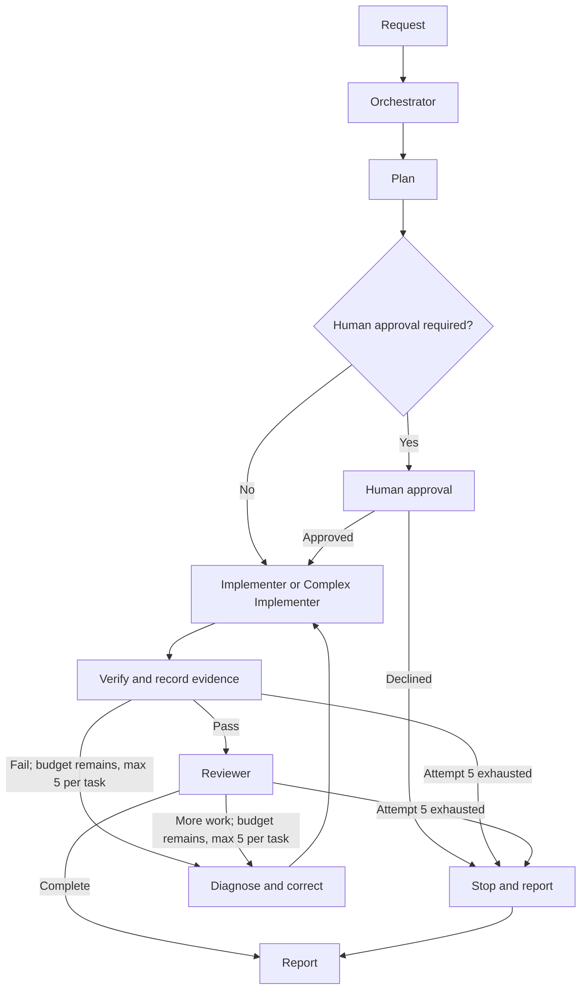

# ORQIVRA

ORQIVRA is a local workflow CLI for turning engineering requests into bounded task plans, attempt history, and verification evidence. It helps prevent lost context during failed checks by giving you one place to record the plan, diagnosis, correction, and results. For example, after a config test fails, record the failing check and diagnosis, correct the input, then add passing evidence while keeping the first attempt.

Python 3.11+ and Node.js 24+ implementations share a contract but run independently; neither CLI requires the other runtime.

## Start in one of two ways

### A. Try the method in an online AI conversation

No ORQIVRA installation is needed. Open the [portable online context](docs/online-llm-context.md), paste its full contents into an online AI conversation, then send a small task such as:

> Use the ORQIVRA method from the context above to plan a small change: reject an empty project name. Show the checks you recommend and state what you have not actually run.

Pasting instructions does not grant tools, permissions, persistent memory, or automatic multi-agent execution. The host runtime and your own authorization controls determine what the assistant can do.

### B. Install the local CLI and, separately, client skills

The v0.3.0 packages are not published. From a source checkout, follow the [quickstart](docs/quickstart.md) to install either the Python CLI or the Node CLI; those routes use the current source and do not require each other's runtime. Do not use npm or PyPI package-install commands for this pre-release.

Installing the CLI does not install a client skill. After setting up the CLI, preview and then install a selected skill to an explicit target. For example, for Codex:

```text
orqivra install --edition codex --target .agents/skills --skill orqivra-orchestrate
orqivra install --edition codex --target .agents/skills --skill orqivra-orchestrate --apply
```

The first command is a dry run. Skill installation writes instruction files; it does not activate a client, change its model, grant tools, or change permissions. See [installation](docs/installation.md) and [client qualification](docs/client-qualification.md).

## How a workflow fits together



These are workflow role names: **Orchestrator**, **Implementer**, **Complex Implementer**, and **Reviewer**. They are distinct from skill names such as `orqivra-orchestrate`, `orqivra-architecture`, `orqivra-verify`, and `orqivra-recover`. This is an illustrative flow, not an automatic agent launch: the work may stay solo, and delegation or independent review depends on runtime capability, authorization, task independence, and ownership.

Try the [workflow examples](examples/README.md), including the [operator-driven onboarding demo](examples/onboarding-demo.md), or inspect the [CLI contract](docs/cli-contract.md). ORQIVRA records evidence; it does not execute commands copied into an evidence record.

## Project status

ORQIVRA 0.3.0 is an unpublished pre-release. The latest [GitHub Actions run](https://github.com/Yassatiqi/orqivra/actions/runs/38479211635) passed all 10 jobs for commit `fd64f52b1baa3cbe23f87291748086d2747690f3`, including Windows Python 3.11 junction qualification. Client activation, registry ownership, and private vulnerability-reporting setup remain unresolved. No GitHub release or tags were present when checked; npm and PyPI returned 404, which does not reserve either package name. See [compatibility and qualification](docs/compatibility.md).

ORQIVRA is [MIT-licensed](LICENSE).

If this workflow is useful to you, a GitHub star helps others discover the project.

See the [documentation index](docs/README.md) for architecture, CLI details, security boundaries, and release checks.
